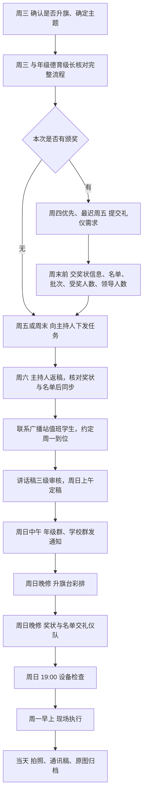
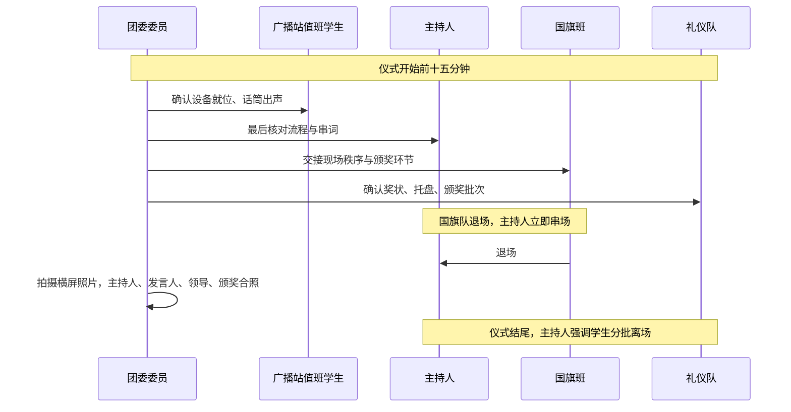
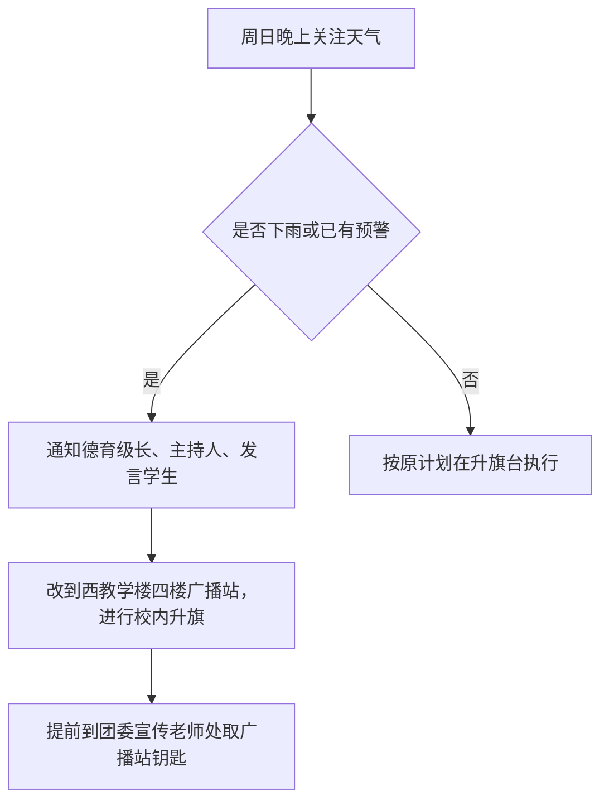

# 升旗仪式工作 SOP

本页把升旗仪式的全部工作按时间顺序排好，负责升旗的团委委员从上往下逐项执行，一次升旗即告完成。节奏是周三启动、周一执行、当天收尾。

页面只写角色与环节，不写个人姓名和联系方式；具体对接人名单见团委内部联系人表。

## 一、时间节点一览

| 时间 | 要完成的事 | 对接方 |
| --- | --- | --- |
| 周三 | 确认本周是否升旗，确定主题 | 团委书记 |
| 周三 | 核对完整流程：是否颁奖、发言人（学生+领导）、颁奖嘉宾、颁奖批次 | 对应年级德育级长 |
| 周四（最迟周五） | 有颁奖则提交礼仪需求 | 礼仪队负责老师 |
| 周末前 | 奖状信息、颁奖名单、批次、受奖人数、颁奖领导人数 | 礼仪队负责老师 |
| 周五或周末 | 向主持人下发主题与完整流程，要求周六返稿 | 主持人 |
| 周五至周日 | 国旗下讲话稿三级审核，周日上午定稿 | 学生、语文老师、德育级长 |
| 周日前 | 下发升旗流程，约好周一早到位 | 广播站值班学生 |
| 周日中午 | 发升旗通知：升旗年级、注意事项、学生站位 | 年级群、学校群 |
| 周日晚修 | 升旗台彩排；奖状与名单交礼仪队 | 主持人、发言学生、礼仪队 |
| 周日 19:00 | 全套设备检查 | 电教 |
| 周一早上 | 现场执行与拍摄 | 全体工作人员 |
| 周一当天 | 通讯稿与照片归档 | 团委宣传老师 |

## 二、流程总览

## 三、周中筹备

### 第 1 步 周三：确认升旗与主题

找团委书记确认本周是否升旗。主题由升旗年级提供；年级暂时没有想法时，用团委提供的默认主题。

### 第 2 步 周三：与年级德育级长核对完整流程

一次问清四件事：是否颁奖、发言人是谁、颁奖嘉宾是谁、颁奖分几批。这四项决定礼仪需求、主持人串词、现场排队的具体安排。

### 第 3 步 有颁奖：周四提出礼仪需求，最迟周五

礼仪需求优先周四提，最迟周五，交给礼仪队负责老师。周末前把奖状信息、颁奖名单、颁奖批次、受奖人数、颁奖领导人数一并告知，礼仪队才能提前备好托盘与奖状。

## 四、周末筹备

### 第 4 步 向主持人下发任务

周五或周末下发，给到主题和完整流程，要求周六返稿。有颁奖的，同时核对奖状与颁奖名单，确认无误后同步给主持人，串词里才会出现正确的奖项与人名。

### 第 5 步 对接广播站

联系广播站两名值班学生，下发升旗流程，约定周一早上到南门广播站操作设备。

### 第 6 步 国旗下讲话稿三级审核

学生讲话时间为 3~5 分钟。流程是学生初稿、本班语文老师初审、年级德育级长复审、本人终审，周日上午完成定稿。留出半天改稿时间。

领导讲话一般 5 分钟左右。

### 第 7 步 周日中午发布升旗通知

在年级群、学校群同时发布，写清升旗年级、注意事项、学生站位。

### 第 8 步 周日晚修：升旗台彩排

提前与主持人、发言学生约定周日 18:00 至 18:30 之间的一个时间，到升旗台左侧彩排走位，要求声音洪亮有气势。可使用文件板。

### 第 9 步 周日晚修：奖状与名单交礼仪队

把奖状和颁奖名单交给礼仪队，让礼仪队当晚就能分好批次、确定托盘样式。

### 第 10 步 周日 19:00：设备检查

在群内对接电教，检查全套设备：话筒、音响、国歌音源、备用电池。

## 五、周一现场

### 第 11 步 提前到场

工作人员全部提前到岗；广播站两名学生按时到南门广播站值守，试音一遍。

### 第 12 步 国旗班协助现场

请国旗班协助现场秩序与颁奖环节协调，重点是队列与上台路线。

### 第 13 步 流程把控

国旗队退场过程中主持人立即串场，不留空场；仪式结尾由主持人强调学生分批离场，避免散场拥堵。

### 第 14 步 颁奖环节

由另一名团委委员在面向主席台左侧集结领奖学生，按名单顺序排好队。主持人刚念到颁奖内容，领奖学生就开始上台，不等念完，节奏才紧凑。学生领奖同样要拍照。

### 第 15 步 拍摄

现场照片一律横屏：主持人讲话、发言人讲话、领导讲话、颁奖合照，四类各取可用画面。

## 六、事后收尾

### 第 16 步 撰写通讯稿

结构固定：开头简述活动，中间嵌入学生发言稿内容，结尾总结。稿件里插入图片，并给每张图配一句文字说明，写清图中人物是谁，方便公众号编辑核对。

### 第 17 步 原图归档

原图发给团委宣传老师，不做压缩。

## 七、雨天预案

雨天这件事要在周日就讲清楚，通知对象是德育级长、主持人和发言学生三方。广播站钥匙在团委宣传老师处，周一早上再取容易来不及。

## 八、执行清单

- [ ] 周三确认是否升旗、定主题
- [ ] 周三核对流程：颁奖、发言人、颁奖嘉宾、批次
- [ ] 周四或周五提交礼仪需求
- [ ] 周末前交奖状信息、名单、批次、人数
- [ ] 主持人任务下发并收回返稿
- [ ] 广播站值班学生对接完毕
- [ ] 讲话稿三级审核完成、周日上午定稿
- [ ] 周日中午发升旗通知
- [ ] 周日晚修升旗台彩排
- [ ] 奖状与名单交礼仪队
- [ ] 周日 19:00 设备检查
- [ ] 周一早上工作人员与广播站到位
- [ ] 颁奖环节排队与拍照
- [ ] 现场照片拍齐四类
- [ ] 通讯稿写好、图片配说明
- [ ] 原图发给团委宣传老师
- [ ] 雨天方案已提前告知三方
