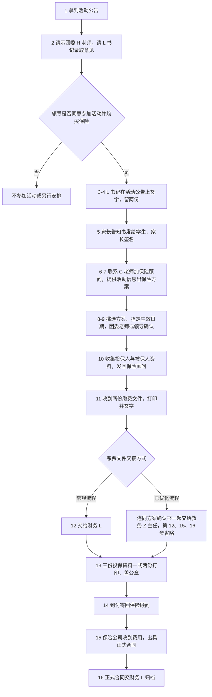

# 学生社团外出参赛保险购买流程

学生社团外出参加比赛或活动，学校要为参加学生代购一份短期意外伤害保险。本页把整件事按顺序排成 16 步：先办活动审批，再做家长知情同意，然后确认保险方案、收集资料、缴费、盖章投保，最后归档合同。

页面以姓名首字母标注对接人，不写全名与联系方式。

## 一、流程总览

## 二、活动审批（第 1–4 步）

### 第 1 步 拿到活动公告

取得比赛或活动的正式公告，确认主办方、时间、地点与参加项目。

### 第 2 步 请示 L 书记录取意见

先向团委 H 老师汇报，请他帮忙问团委 L 书记录取两件事的意见：

- 是否同意学生参加本次活动；
- 是否同意学校帮学生购买保险。

### 第 3 步 等待领导同意

团委领导同意学生参加活动、同意学校代购保险后，再往下走。

### 第 4 步 书记在活动公告上签字

打印活动公告，请团委 L 书记签署意见：“同意 xxx 带领同学参加活动，学校购买保险。”

最好打印两份都签好，留一份备用。这份签过名的活动公告是后续请款、盖公章的凭证，整个流程都要带着它。

## 三、家长知情（第 5 步）

### 第 5 步 学生带回家长告知书签名

让参加的学生把“活动家长告知书”（模板在团委 H 老师处）带回家，由家长签名。告知书在学生参加活动和学校代购保险之前收齐，后面提交投保资料时要用。

## 四、保险方案（第 6–9 步）

### 第 6 步 获取保险顾问联系方式

联系 C 老师，加保险顾问的联系方式。

### 第 7 步 保险顾问出方案

把活动信息提供给保险顾问，让他出“保险方案”。学生活动一般购买人身意外伤害保险。

### 第 8 步 挑选方案并请示

挑选方案、指定生效日期，再请示团委老师或者领导。参考值：学生活动一天，保费每人 9 元左右、保额 10 万元，即可满足基本要求。

### 第 9 步 确认方案

方案确认后告知保险顾问，按此方案出具缴费文件。

## 五、资料收集（第 10 步）

### 第 10 步 收集投保人与被保人信息

整理以下资料，发回给保险顾问。

投保人（学校）：

- 学校的事业单位法人证书，作用类似企业的营业执照；
- 本次保险经办人的身份证正反面复印件，复印在同一张 A4 纸上。

被保人（参加学生及其家长）：

- 学生：姓名、班级、身份证号、电话号码；
- 学生家长：姓名、身份证号、电话号码。

身份证号直接决定保单是否有效，收齐后逐人核对一遍；参加名单有变动时，更新后再提交。

## 六、缴费（第 11–12 步）

### 第 11 步 收取并签署两份缴费文件

等保险顾问出保险缴费文件（两个文件），打印并签字：

- 保险方案确认书：按审批流程签字。
- 汇款通知书（领导称其为“请款单”或者“汇款单”）：在表格最下面依次填写签署：
  - 用途：用于 xxx 活动购买保险；
  - 经办人：负责人（一般是带队老师）签名；
  - 证明人：L 书记签名；
  - 审批人：按费用金额签——费用在一千元以内，J 副校长签名；费用在一千元以上，正校长签名。

### 第 12 步 缴费文件交财务

把两份缴费文件交给财务 L 办理缴费。

:::info 学校已优化部分流程
在第 11 步，将 L 书记签过名的汇款通知书，连同保险方案确认书，两个文件一起交给教务 Z 主任即可。后续的第 12、15、16 步都可以省略。
:::

## 七、投保资料与盖章（第 13–14 步）

### 第 13 步 收取三份投保资料，打印盖章

等保险顾问出投保资料（三个文件），打印一式两份，盖公章：

| 资料 | 盖章位置 | 备注 |
| --- | --- | --- |
| 汇交申请书（乙） | “汇交人签字/盖章”处盖公章 | 不用签名 |
| 投被保险人清单 | “汇交人签字/盖章”处盖公章 | 不用签名 |
| 发票申请汇交业务发票申请表及声明 | 只打印“增值税发票申请（汇交件向汇交人开票）”，在“申请企业公章（或个人签名）”处盖公章 | 不用签名 |

去盖章时，最好拿着 L 书记签名过的活动公告，避免办公室工作人员不允许盖公章。

### 第 14 步 资料寄回保险顾问

联系保险顾问，把三份盖好章的投保资料，用到付的方式寄回。

## 八、合同归档（第 15–16 步）

### 第 15 步 保险公司出具正式合同

保险公司收到学校缴纳的费用后，出具已投保的正式合同。

### 第 16 步 正式合同交财务

把正式合同交给财务 L 归档。走已优化流程的，这一步由教务 Z 主任跟进，无需经办老师处理。

## 九、资料与签章速查

| 环节 | 资料 | 谁签 / 谁盖 | 份数 | 去向 |
| --- | --- | --- | --- | --- |
| 活动审批 | 活动公告 | L 书记签批意见 | 两份（一份备用） | 带队老师留存，盖章凭证 |
| 家长知情 | 活动家长告知书 | 家长签名 | 每生一份 | 学校收齐保存 |
| 缴费 | 保险方案确认书 | 经办签字 | 一份 | 财务 L；已优化流程交教务 Z 主任 |
| 缴费 | 汇款通知书（请款单） | 经办人、证明人 L、审批人 J 副校长或正校长 | 一份 | 同上 |
| 投保 | 汇交申请书（乙） | 盖公章 | 一式两份 | 到付寄回保险顾问 |
| 投保 | 投被保险人清单 | 盖公章 | 一式两份 | 同上 |
| 投保 | 发票申请表及声明 | 盖公章 | 一式两份 | 同上 |
| 归档 | 正式保险合同 | —— | —— | 财务 L（已优化流程由教务 Z 主任跟进） |

## 十、执行清单

- [ ] 拿到活动公告
- [ ] 请示团委 H 老师，由 L 书记录取“同意参加、同意购保”意见
- [ ] 活动公告打印两份，L 书记签好，留一份备用
- [ ] 家长告知书发下去、家长签名、收齐
- [ ] 添加保险顾问，提供活动信息，拿到保险方案
- [ ] 挑选方案、指定生效日期，团委老师或领导确认
- [ ] 投保人资料备齐：事业单位法人证书 + 经办人身份证正反面（同一张 A4）
- [ ] 被保人信息收齐：学生（姓名、班级、身份证号、电话）+ 家长（姓名、身份证号、电话），逐人核对
- [ ] 保险方案确认书打印并签字
- [ ] 汇款通知书按金额签齐：经办人、证明人、审批人
- [ ] 缴费文件交接：常规交财务 L；已优化流程连同确认书交教务 Z 主任
- [ ] 三份投保资料一式两份打印、盖公章（带上 L 书记签名的活动公告）
- [ ] 投保资料到付寄回保险顾问
- [ ] 正式合同到手归档（常规交财务 L）
