# “i志愿”注册并加入常平中学青年志愿者服务队

“i志愿”全称“广东省志愿者信息管理服务平台”，为志愿者提供实名注册、活动报名、服务时长记录等功能。

平台还推动人员、组织、活动的供需对接，实现志愿服务全过程一体化、流程化的在线服务管理。

本页从关注公众号开始，一路走到加入校内服务队，共 10 步：前 8 步是首次注册，后 2 步供已注册的同学加入服务队。后面还有报名、签到签退与常见问题。

## 一、注册流程

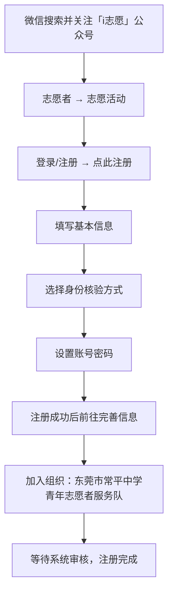

### 第 1 步 搜索并关注公众号

打开微信，点击右上角进入搜索框，搜索“i志愿”，进入官方服务号，关注账号并私信。

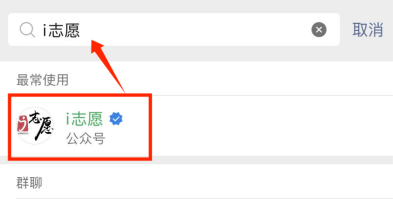

### 第 2 步 进入志愿活动

点公众号左下角的“志愿者”，再点“志愿活动”。

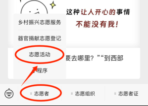

### 第 3 步 打开注册页面

点页面上方的“登录/注册”进入登录界面，再点下方的“点此注册”。

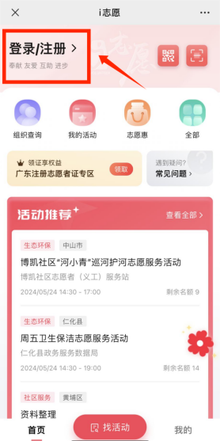

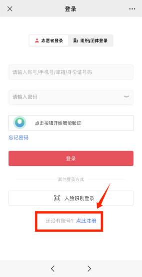

### 第 4 步 填写基本信息

填写姓名、身份证号、手机号（均为实名必填），收取验证码，勾选协议后点“下一步”。

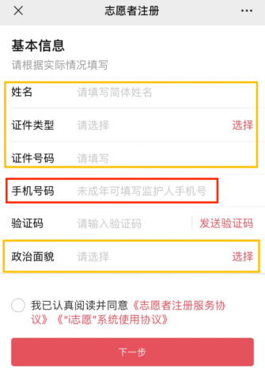

:::note

1. 姓名、身份证号码、政治面貌均填写本人实际信息。
2. 未成年人可填写监护人手机号码；要先点智能验证，才能点发送验证码。

:::

### 第 5 步 完成身份核验

在“任一项身份核验方式”里选一种，点“下一步”。

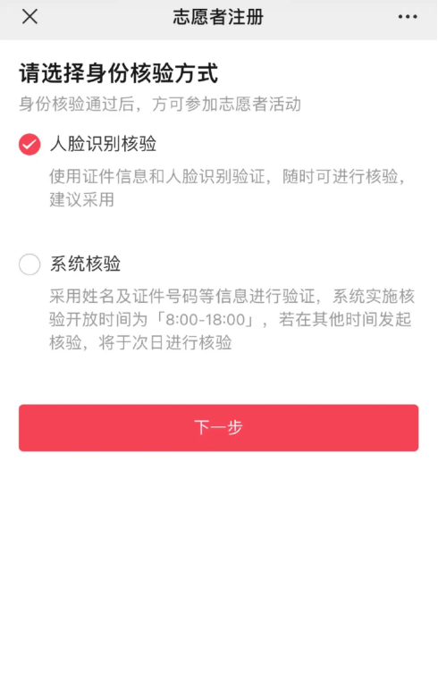

人脸识别核验需本人操作，按页面提示完成。

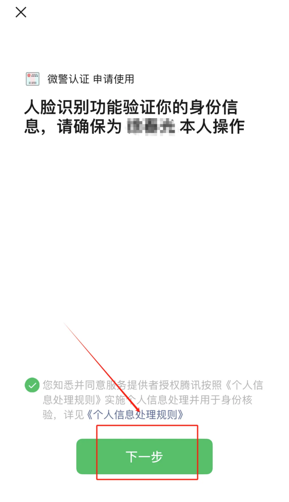

### 第 6 步 设置账号密码

按页面要求设置账号与密码，务必保存好账号及密码。

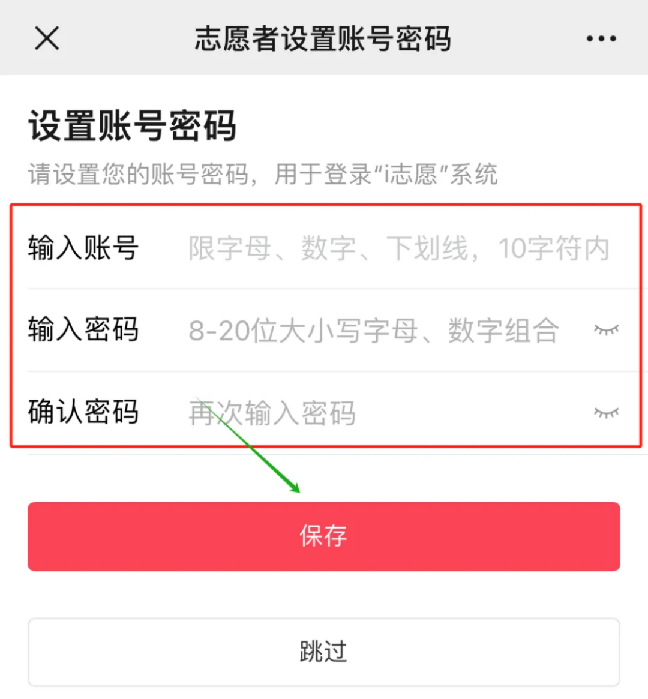

### 第 7 步 完善个人信息

注册成功后点“前往完善”，按提示完善信息。

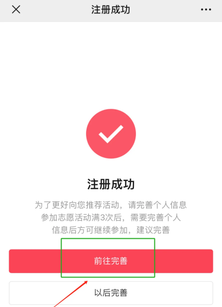

参加 3 次活动后必须完善信息才能报名，建议注册时一次填完。

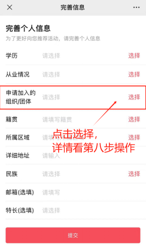

### 第 8 步 加入服务队

点“加入组织”，搜索“东莞市常平中学青年志愿者服务队”，再点“选择组织”。

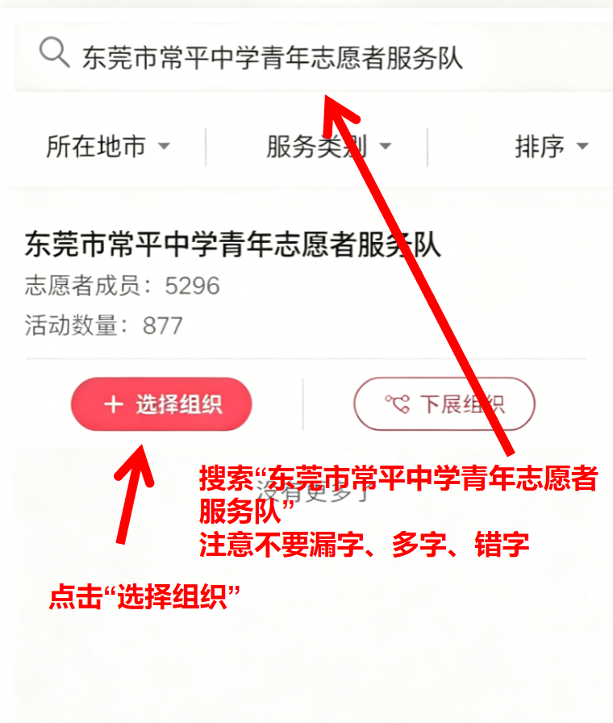

:::note

搜索词写“东莞市常平中学青年志愿者服务队”，不要漏字、多字或错字。

在搜索栏输入关键字后一定要点右下角的搜索键；不同手机的搜索键可能是“搜索”“回车”或“换行”。

加入组织后等候系统审核，审核通过即完成注册，之后可报名校内志愿活动。

:::

## 二、已注册志愿者加入服务队

已经注册过的同学从这一步开始，两步即可加入服务队。

### 第 9 步 进入归属组织

登录“i志愿”进入个人信息页面，点“归属组织”。

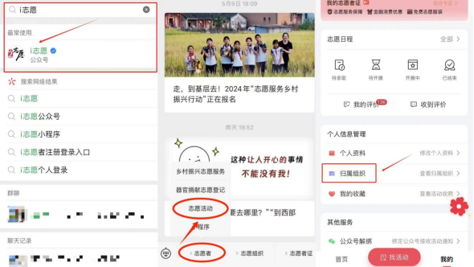

### 第 10 步 添加组织

选“添加组织”，搜索“东莞市常平中学青年志愿者服务队”，点申请后等待通过。

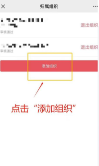

## 三、报名校内志愿活动

各位同学可加入志愿者协会青培部志愿交流群，群内会定期及不定期发布校内志愿服务招募通知。

报名前须完成志愿者注册并加入“东莞市常平中学青年志愿者服务队”，未按要求完成操作的，相关志愿服务时长不予录入。

:::warning

凡无故缺席已成功报名的志愿服务活动累计三次者，自第三次缺席之日起，一个月内不得参与志愿服务活动。

:::

## 四、签到与签退

报名成功后，活动开展前负责人会发放签到签退表。以工整清晰的正楷字，在“班级”栏填写班级及姓名，在“签到”栏签署姓名。

活动结束后到指定集合地点，同样用正楷在“签退”栏签名，完成签退。

:::note

字迹潦草模糊、难以辨识会导致平台审核不予通过，本次签到、签退视作无效。请用正楷填写，保证每个字都看得清。

:::

## 五、常见问题

### Q1 提示“证件号码已被注册”或“手机号码已被注册”，找回密码又提示“该账号不存在”或“未注册”

遇到这种情况需要联系 i志愿 后台客服，恢复账号或手机号码的使用权。

把身份证、姓名、手机号码和问题描述发到 i志愿 客服邮箱 [kf@izyz.org](mailto:kf@izyz.org)。

### Q2 注册用的手机号不再使用或不是本人手机号，怎么更换

1. 进入粤省事小程序，按“志愿服务 → 个人中心 → 账户设置 → 安全设置 → 手机号”重新绑定。
2. 进入 i志愿 公众号，按“志愿者 → 志愿活动 → 我的 → 个人资料”进入，点手机号码右侧的“更换”按钮后修改。

### Q3 忘记密码怎么办

1. 微信手机端：在微信搜索并关注“i志愿”公众号，选择“志愿者 → 志愿活动 → 登录/注册 → 忘记密码”，通过手机短信找回。
2. 电脑端：打开 [找回密码页面](https://www.izyz.org/change-password/1)，通过账号认证找回。
3. 粤省事志愿服务：刷脸或用微信支付密码登录粤省事，进入志愿服务界面，在个人中心的账户设置里修改密码。

电脑端输入证件号码后，可选择手机短信找回、邮箱验证找回或提交申诉资料。

### Q4 正常签到签退，但志愿时长未录入或审核失败

常见原因有两个：签到签退字迹模糊、信息难以识别；志愿时长录入系统处于维护阶段。

在志协青培部志愿群内向干部反馈即可。正常完成签到、签退而审核未通过的，统一重新录入；活动录入时限已过的，通过其他方式补录。

更多问题可登录网页版 i志愿 查看“帮助中心”，或在志协青培部志愿群内询问。
